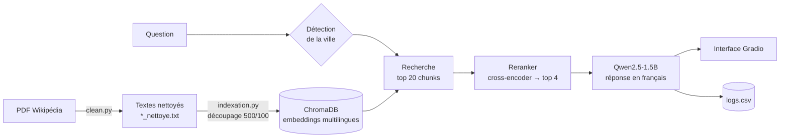

# 🏙️ Chatbot Expert des Capitales du Monde (RAG Local & CPU/GPU)

Un assistant conversationnel intelligent en **français** basé sur une architecture **RAG** (*Retrieval-Augmented Generation*). Il répond à des questions factuelles et touristiques sur une trentaine de capitales mondiales à partir de documents Wikipédia nettoyés, **sans aucune dépendance à une API externe payante** (le tout s'exécute entièrement en local).

> **Exemples de requêtes :** *« Quelle est la population d'Ottawa ? »*, *« Qui a conçu les bâtiments de Brasilia ? »*, *« Depuis quand Abuja est-elle la capitale du Nigeria ? »*

Le projet intègre un pipeline complet de traitement des données, un système de **reranking**, une interface web fluide (Gradio), ainsi qu'un **module d'évaluation automatisé rigoureux** (99 questions de test).

---

## ✨ Fonctionnalités Clés

- 🔎 **Recherche Sémantique Avancée** : Indexation vectorielle via ChromaDB et embeddings multilingues.
- 🎯 **Routage Intelligent** : Détection automatique de la ville ciblée dans le message (reconnaissance du nom explicite ou d'alias : *« Eiffel » → Paris*, *« Japon » → Tokyo*).
- ⚡ **Reclassement par Reranker** : Utilisation d'un Cross-Encoder (`mmarco-mMiniLMv2`) pour trier et filtrer les 20 meilleurs candidats avant de n'en retenir que 4 pour le LLM.
- 🤖 **Inférence Locale Sécurisée** : Propulsé par `Qwen2.5-1.5B-Instruct` (optimisé fp16 sur GPU ou exécution sur CPU).
- 🌦️ **Micro-service Météo** : Intégration en temps réel de l'API Open-Meteo via une liste déroulante indépendante.
- 📊 **Observabilité & Logs** : Enregistrement automatique de chaque interaction dans `logs.csv` pour un suivi analytique ultérieur (Power BI).

---

## 🧱 Architecture Technique



| Composant | Choix Technologique | Justification |
|---|---|---|
| **Modèle de Langage (LLM)** | `Qwen/Qwen2.5-1.5B-Instruct` | Excellent équilibre taille/performance pour tourner localement sur CPU ou petit GPU. |
| **Embeddings** | `sentence-transformers/paraphrase-multilingual-MiniLM-L12-v2` | Capture fine du sens sémantique multilingue. |
| **Reranker** | `cross-encoder/mmarco-mMiniLMv2-L12-H384-v1` | Garantit une haute précision de contexte en réévaluant la pertinence croisée. |
| **Base Vectorielle** | ChromaDB (via LangChain) | Légère, persistante en local et simple à filtrer par métadonnées. |
| **Découpage (Chunking)** | `RecursiveCharacterTextSplitter` (500 car. / overlap 100) | Taille idéale pour les fenêtres de contexte du modèle. |

---

## 🌍 Villes Couvertes

| | | | |
|---|---|---|---|
| Abuja | Addis-Abeba | Barcelone | Berlin |
| Brasilia | Buenos Aires | Canberra | Casablanca |
| Le Caire | Londres | Lyon | Madrid |
| Marrakech | Marseille | Mexico | New Delhi |
| New York | Ottawa | Paris | Pékin |
| Pretoria | Rabat | Riyad | Singapour |
| Sydney | Tokyo | Washington | Wellington |

Le chatbot détecte automatiquement les villes disponibles : il suffit d'ajouter un fichier `<Ville>_nettoye.txt` dans `data/` puis de relancer l'indexation.

---

## 📊 Évaluation et Analyse des Performances

Pour s'assurer de la fiabilité du chatbot et éviter les hallucinations, un script d'évaluation rigoureux (`evaluate.py`) a été mis en place sur un jeu de test de **99 questions** réparties sur 12 villes.

Chaque réponse est évaluée à l'aide d'une **normalisation stricte** (minuscules, suppression des accents et de la ponctuation) pour croiser les mots-clés attendus avec le contexte récupéré et la réponse générée.

### 1. Où se perdent les erreurs ? (Analyse du Pipeline RAG)


Le taux de réussite global se stabilise autour de **75 % de réponses correctes**, pour un taux de récupération de bons passages (*retrieval*) avoisinant les **89 % sur GPU**. 

Cela met en évidence une fuite d'environ 14 points entre le moment où le bon document est trouvé dans les fichiers et le moment où le LLM formule sa réponse finale : le modèle peine parfois à extraire un chiffre ou un nom propre précis au milieu d'un passage textuel bruité.

### 2. Performances par Catégorie et par Ville


- **Par catégorie de questions** : Les **dates** obtiennent les meilleurs scores de réussite (≈ 81 %), suivies de près par les **chiffres** (78 %) et les **lieux/noms** (72 %). Les questions portant sur les **personnes** s'avèrent légèrement plus délicates (71 %).
- **Par ville** : Des villes comme *Ottawa* et *Addis-Abeba* atteignent 100 % de réussite, tandis que des capitales aux structures documentaires plus denses (*Buenos Aires*, *Canberra*, *Pretoria*) présentent un taux d'erreur plus élevé en raison de la complexité de leurs données démographiques ou historiques.

### 3. Impact de la longueur de réponse sur la durée


La durée de génération est **fortement corrélée à la longueur de la réponse produite ($r = 0,77$)**. Une réponse très courte prend environ 8,8 secondes de base, tandis qu'une réponse développée de 400 caractères monte à près de 18-20 secondes. Cela valide l'importance de contraindre le `MAX_NEW_TOKENS` et d'imposer des consignes strictes de concision dans le prompt système.

---

## 🚀 Installation et Utilisation

### 1. Clonage et Environnement
```bash
git clone <url-du-depot>
cd <nom-du-depot>
python -m venv venv
source venv/bin/activate        # Sur Windows : venv\Scripts\activate
pip install -r requirements.txt
```

### 2. Indexation des Données
Placez vos fichiers PDF sources dans le dossier `data/`, puis exécutez le script de nettoyage et d'indexation :
```bash
python clean.py          # Nettoie les PDF et génère les fichiers *_nettoye.txt
python indexation.py     # Construit la base vectorielle ChromaDB
```

### 3. Lancer l'Application Gradio
```bash
python app.py
```
L'interface web locale s'ouvre sur `http://127.0.0.1:7860`.

### 4. Lancer le Module d'Évaluation
```bash
python evaluate.py                   # Évaluation complète (Retrieval + Réponses)
python evaluate.py --retrieval       # Évaluation rapide de la recherche seule
python evaluate.py --ville Ottawa    # Filtrer l'évaluation sur une ville spécifique
```

---

## 📁 Structure du Projet

```text
.
├── app.py                   # Chatbot (RAG + interface Gradio + météo + logs)
├── clean.py                 # Extraction et nettoyage des PDF Wikipédia
├── indexation.py            # Découpage + embeddings + création de ChromaDB
├── evaluate.py              # Évaluation automatique du chatbot
├── test_questions.json      # 99 questions de test (12 villes)
├── requirements.txt
├── data/                    # PDF sources et textes *_nettoye.txt
├── chroma_db/               # Base vectorielle (générée)
├── logs.csv                 # Journal des questions (généré)
├── evaluation_resultats.csv # Résultats détaillés de l'évaluation (généré)
└── docs/img/                # Graphiques d'analyse de l'évaluation
```

---

## ⚠️ Limites et Pistes d'Amélioration

- **Évaluation par mots-clés** : Strictement binaire, elle peut pénaliser une bonne réponse reformulée sans le mot exact. L'ajout d'un *LLM-as-a-Judge* permettrait d'affiner cette mesure.
- **Couverture du jeu de test** : Étendre `test_questions.json` des 12 villes actuelles à l'ensemble des 28 destinations de la base.
- **Recherche hybride** : Combiner une recherche lexicale (BM25) aux vecteurs pour améliorer la précision sur les chiffres et les noms propres.
- **Mémoire conversationnelle** : Ajouter une reformulation des questions de suivi (ex: *« Et sa superficie ? »*).

---

👤 S.Younes

