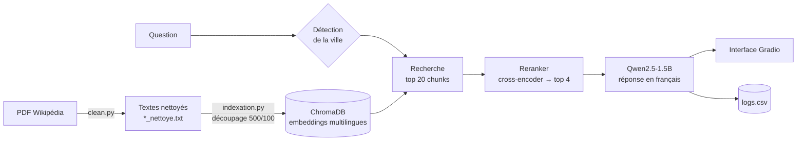

# 🏙️ Chatbot Expert des Capitales du Monde

Un chatbot touristique en **français** basé sur une architecture **RAG** (*Retrieval-Augmented Generation*) : il répond à des questions sur une trentaine de capitales et grandes villes à partir d'une base documentaire issue de pages Wikipédia, **sans API externe payante** : tout tourne en local (CPU ou GPU).

> Exemple : *« Quelle est la population d'Ottawa ? »*, *« Qui a conçu les bâtiments de Brasilia ? »*, *« Depuis quand Abuja est-elle la capitale du Nigeria ? »*

Le projet inclut aussi une **évaluation quantitative** (99 questions de test) et une **comparaison CPU → GPU** : le passage sur une GTX 1650 divise le temps de réponse par **~5** et améliore la récupération des bons passages de **80 % à 89 %**.

---

## ✨ Fonctionnalités

- 🔎 **Recherche sémantique** multilingue dans une base vectorielle ChromaDB
- 🏷️ **Détection automatique de la ville** visée par la question (nom de la ville ou alias : *« Eiffel » → Paris*, *« Japon » → Tokyo*…)
- 🎯 **Filtrage par ville** + **reclassement (reranking)** des passages par un cross-encoder
- 🤖 **Génération** de la réponse par `Qwen2.5-1.5B-Instruct`, contrainte à se baser uniquement sur le contexte
- 🌦️ **Météo en direct** (API Open-Meteo) via une liste déroulante, indépendante du chatbot
- 📝 **Journal d'utilisation** (`logs.csv`) exploitable dans Power BI
- 📊 **Script d'évaluation** automatique (retrieval + réponse) avec export CSV

---

## 🧱 Architecture



| Composant | Choix technique |
|---|---|
| Modèle de langage | `Qwen/Qwen2.5-1.5B-Instruct` (fp16 sur GPU, CPU sinon) |
| Embeddings | `sentence-transformers/paraphrase-multilingual-MiniLM-L12-v2` |
| Reranker | `cross-encoder/mmarco-mMiniLMv2-L12-H384-v1` |
| Base vectorielle | ChromaDB (via LangChain) |
| Découpage | `RecursiveCharacterTextSplitter`, chunks de 500 caractères, chevauchement 100 |
| Interface | Gradio |
| Météo | Open-Meteo (gratuit, sans clé) |

### Choix de conception notables

- **Chaque chunk est préfixé par `Ville : <nom>`** à l'indexation : le morceau « sait » de quelle ville il parle, ce qui limite les confusions entre villes.
- **Métadonnée `source`** utilisée pour filtrer la recherche sur le fichier de la ville détectée.
- **Récupération en deux temps** : 20 candidats par similarité vectorielle, puis reclassement fin par cross-encoder, et seulement 4 passages envoyés au LLM (`K_CHUNKS = 4`).
- **Réponses courtes** (`MAX_NEW_TOKENS = 150`, 1 à 3 phrases) pour la rapidité et la précision.
- **Nettoyage des PDF** adapté à Wikipédia : suppression des références, numéros de notes, URL, légendes de cartes/graphiques, correction des césures.

---

## 🌍 Villes couvertes

| | | | |
|---|---|---|---|
| Abuja | Addis-Abeba | Barcelone | Berlin |
| Brasilia | Buenos Aires | Canberra | Casablanca |
| Le Caire | Londres | Lyon | Madrid |
| Marrakech | Marseille | Mexico | New Delhi |
| New York | Ottawa | Paris | Pékin |
| Pretoria | Rabat | Riyad | Singapour |
| Sydney | Tokyo | Washington | Wellington |

Le chatbot détecte automatiquement les villes disponibles : il suffit d'ajouter un fichier `<Ville>_nettoye.txt` dans `data/` puis de relancer l'indexation.

---

## 📁 Structure du projet

```
.
├── app.py                  # Chatbot (RAG + interface Gradio + météo + logs)
├── clean.py                # Extraction et nettoyage des PDF Wikipédia
├── indexation.py           # Découpage + embeddings + création de ChromaDB
├── evaluate.py             # Évaluation automatique du chatbot
├── test_questions.json     # 99 questions de test (12 villes)
├── requirements.txt
├── data/                   # PDF sources et textes *_nettoye.txt
├── chroma_db/              # Base vectorielle (générée)
├── logs.csv                # Journal des questions (généré)
├── evaluation_resultats.csv# Résultats détaillés de l'évaluation (généré)
└── docs/img/               # Graphiques utilisés dans ce README
```

---

## 🚀 Installation et utilisation

### 1. Prérequis

- Python 3.10+
- (Recommandé) un GPU NVIDIA avec PyTorch CUDA : le projet tourne avec **4 Go de VRAM** (testé sur GTX 1650)

```bash
git clone <url-du-depot>
cd <nom-du-depot>
python -m venv venv
source venv/bin/activate        # Windows : venv\Scripts\activate
pip install -r requirements.txt
```

> Pour profiter du GPU, installez la version de PyTorch compatible CUDA depuis [pytorch.org](https://pytorch.org/get-started/locally/).

### 2. Préparer les données

Placez les PDF Wikipédia des villes dans `data/`, puis :

```bash
python clean.py          # génère data/<Ville>_nettoye.txt
python indexation.py     # construit chroma_db/
```

> Le nom du fichier détermine le nom de la ville : `Ottawa.pdf` → `Ottawa_nettoye.txt`.

### 3. Lancer le chatbot

```bash
python app.py
```

L'interface Gradio s'ouvre sur `http://127.0.0.1:7860`. Citez la ville dans la question ; sinon le chatbot cherche dans toutes les villes.

### 4. Lancer l'évaluation

```bash
python evaluate.py                       # retrieval + réponses du modèle
python evaluate.py --retrieval           # retrieval seul (rapide)
python evaluate.py --ville Ottawa        # une seule ville
```

---

## 📊 Évaluation

### Méthode

Le jeu de test `test_questions.json` contient **99 questions** sur **12 villes** (8 à 9 par ville), chacune associée à des **mots-clés attendus**. Pour chaque question, `evaluate.py` mesure :

| Métrique | Définition |
|---|---|
| **Retrieval** (« bon passage trouvé ») | Le contexte récupéré contient au moins un mot-clé attendu |
| **Réponse juste** | La réponse générée contient au moins un mot-clé attendu |
| **Durée** | Temps total (recherche + reclassement + génération) |

Les comparaisons sont normalisées (minuscules, sans accents ni ponctuation : `4 026 000` = `4026000`). Une question est **ignorée** si son mot-clé n'existe pas dans le fichier source, ce qui garantit des questions valides.

Les questions ont ensuite été regroupées en 4 catégories pour l'analyse : **Dates**, **Chiffres**, **Personnes**, **Lieux et noms**.

### Résultats globaux : CPU vs GPU

| | CPU (référence) | GPU GTX 1650 | Évolution |
|---|---|---|---|
| Questions testées | 91 | 99 | |
| Bon passage trouvé | 80,2 % (73/91) | **89 %** (88/99) | **+9 points** |
| Réponses justes | 74,7 % (68/91) | **75 %** (74/99) | stable |
| Durée moyenne | 55,3 s | **10,8 s** | **÷ 5,1** |

> ⚠️ Les jeux de questions ne sont pas strictement identiques (91 vs 99 questions) : la comparaison est indicative.

### ⏱️ Gain de vitesse


Sur CPU, la majorité des réponses prennent **40 à 70 secondes** (avec des pointes au-delà de 130 s). Sur GPU, **toutes les réponses sauf une arrivent en moins de 20 secondes**, et la durée moyenne est homogène d'une ville à l'autre (~10 s), ce qui rend le chatbot réellement utilisable en conversation.

### 🎯 Qualité des réponses (GPU)


- **Par ville** : Ottawa et Addis-Abeba atteignent 100 % de réponses justes ; les villes les plus difficiles sont **Buenos Aires** (≈ 50 %), **Riyad**, **Canberra** et **Pretoria** (≈ 62-67 %).
- **Par catégorie** : les **dates** sont les mieux traitées (retrieval 100 %, réponses ≈ 81 %), suivies des chiffres (≈ 94 % / 78 %) et des lieux et noms (≈ 86 % / 72 %). Les questions sur les **personnes** sont les plus faibles (≈ 71 %), mais ne représentent que 7 questions.

### 📉 Point de comparaison : résultats sur CPU


Sur CPU, la même tendance apparaît : dates parfaites (100 %), chiffres (≈ 76 %), personnes (≈ 71 %), lieux et noms (≈ 68 %). Les villes les plus faibles étaient déjà Buenos Aires, Riyad et Washington, ce qui suggère que **la difficulté vient du contenu des documents** plus que du matériel.

### 🔗 Durée et longueur de la réponse


Sur GPU, la durée est **fortement corrélée à la longueur de la réponse (r = 0,77)** : la génération de tokens domine le temps total. Une réponse de ~50 caractères prend ≈ 10 s, une réponse de 400 caractères ≈ 17 s. Limiter `MAX_NEW_TOKENS` et demander des réponses courtes dans le prompt système reste donc le levier principal de vitesse.

### 🧠 Analyse

1. **Le GPU améliore surtout la vitesse, pas la justesse.** Le modèle et les paramètres étant identiques, la qualité des réponses reste stable (~75 %) ; le gain de 55 s à 11 s est le vrai bénéfice.
2. **Le goulot d'étranglement est la génération.** Avec 89 % de bons passages récupérés pour 75 % de réponses justes, environ 14 points se perdent entre le contexte et la réponse : un modèle de 1,5 milliard de paramètres peine parfois à extraire le bon chiffre ou le bon nom dans un passage bruité.
3. **La récupération est solide** grâce au préfixe `Ville :`, au filtrage par fichier et au reranking.
4. **Les villes les plus faibles** (Buenos Aires, Riyad, Canberra, Pretoria) sont celles dont les articles contiennent des données multiples (plusieurs populations, superficies ou noms) qui prêtent à confusion.

---

## ⚠️ Limites connues

- L'évaluation par **mots-clés** est stricte mais imparfaite : une réponse correcte reformulée sans le mot-clé est comptée fausse, et inversement.
- Le jeu de test couvre **12 villes sur les 28 de la base**.
- Les informations sont figées à la date des PDF Wikipédia (par exemple les maires ou populations peuvent évoluer).
- Un modèle de 1,5 milliard de paramètres limite la finesse de raisonnement sur les questions complexes ou comparatives.

## 🛣️ Pistes d'amélioration

- Passer à un LLM plus grand (Qwen2.5-3B/7B) en quantification 4 bits (`bitsandbytes`)
- Étendre le jeu de test aux 28 villes et ajouter une évaluation par LLM-juge
- Recherche hybride (BM25 + vecteurs) pour les chiffres et noms propres
- Mémoire de conversation pour les questions de suivi (« Et sa superficie ? »)
- Déploiement (Hugging Face Spaces, Docker)

---

## 📈 Suivi d'utilisation avec Power BI

Chaque question posée dans l'interface est enregistrée dans `logs.csv` (date, heure, ville détectée, question, durée, indicateur « sans info », réponse, villes des passages, extrait du contexte), prêt à être importé dans Power BI pour suivre l'usage et détecter les questions sans réponse.

---

## 📚 Données et licences

Les textes proviennent de pages **Wikipédia** exportées en PDF, distribuées sous licence [CC BY-SA 4.0](https://creativecommons.org/licenses/by-sa/4.0/deed.fr). Les modèles utilisés sont distribués par leurs auteurs via Hugging Face (Qwen2.5, sentence-transformers) : consultez leurs licences respectives.

## 👤 Auteur

*SYounes* · [GitHub](https://github.com/yosa789) 
